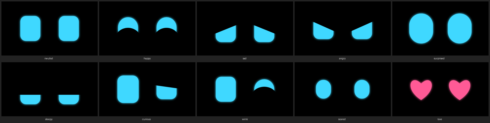

# atl-phone: an old phone as the robot's face, eyes and ears

🇬🇧 An old Android phone as a payload: it shows the face, sees cards, hears and speaks, over ROS 2. The brain stays on the PC.
🇫🇷 Un vieux téléphone Android comme charge utile : il montre le visage, lit les cartes, entend et parle, via ROS 2. Le cerveau reste sur le PC.
🇩🇪 Ein altes Android-Handy als Nutzlast: es zeigt das Gesicht, liest Karten, hört und spricht, über ROS 2. Das Gehirn bleibt auf dem PC.



The phone runs a web page, nothing to install; any phone whose browser is recent enough will do, whatever its
OS (stock Android, LineageOS, …). The ROS 2 node `atl_phone/bridge` serves the page and maps it to topics.

## Start here

```bash
./start.sh            # builds the image if needed, starts the bridge in Docker, opens the setup page
```

The **setup page** (`http://localhost:8782/setup.html`, on this PC only) guides through it, in EN/FR/DE:
the bridge → connecting the phone (USB, or Wi-Fi with a QR code) → the phone check → testing each output
(face, gaze, colour, voice, vibration, torch, camera: you say what you saw) and each sense (touch, motion, compass,
battery, reading a code: they tick by themselves) → a summary to copy. Its tests go through ROS 2, on the contract's
topics; the camera test goes to the phone directly and its picture stays on the phone's screen. A phone on plain
http (Wi-Fi without `--cert`) shows its camera, motion, compass and battery as *blocked*: use USB, or HTTPS.

`./start.sh --robot thymio_1 --port 8782 --lang fr --key KEY` · `./start.sh logs` · `./start.sh stop`

**Wi-Fi with camera and motion:** `./start.sh --make-cert`. It makes this PC's own certificate authority once
(`certs/`, git-ignored; `scripts/make_cert.sh`) and the bridge's certificate for this PC's addresses, renewed when the
address changes. Each phone installs the authority once: the setup page's Wi-Fi tab has a QR code for `ca.crt` and the
steps. Then the bridge speaks only https, over USB too. The authority's key never leaves `certs/`.
Your own certificate instead: `--cert DIR` (`cert.pem`, `key.pem`, and `ca.crt` if the phones should get it).

## By hand

```bash
docker build -f docker/Dockerfile -t atl-phone:kilted .
docker run --rm --net=host --user "$(id -u):$(id -g)" -e HOME=/tmp atl-phone:kilted   # the bridge, for thymio_1
docker run ... atl-phone:kilted ros2 launch atl_phone phone.launch.py robot:=thymio_1 \
    [port:=8782] [key:=...] [cert:=c.pem cert_key:=k.pem [ca:=ca.crt]] [lang:=fr]                    # with arguments
./scripts/usb.sh face.html                                       # USB: adb reverse, then opens the face on the phone
docker exec <container> /entrypoint.sh python3 -m atl_phone.contract_check     # the contract, with a mock phone: 17 checks
python3 scripts/browser_check.py --container <container>         # the face page in headless Chrome as the phone: 7 checks
./test.sh                                                        # protocol, WebSocket, check server: no ROS, no phone
```

**How the phone connects.** Camera, microphone and motion need a *secure* page. Over **USB**, `adb reverse` makes the
bridge the phone's `localhost`, which counts as secure, and the cable charges the phone: the way to set up at the desk.
Over **Wi-Fi** the bridge needs HTTPS (`cert`, `cert_key`, `ca`): `./start.sh --make-cert`, with the authority installed once on each phone.
On the phone, tap ▶: full screen, landscape, the screen stays on. A `key` pairs the bridge with its phones (`/?key=...`).

## The contract: `atl-phone/0.1` (`atl_phone/contract.py`)

Under the robot that carries the phone, so `/thymio_1/phone/...`; the robot's own contract stays as it is.

| Topic under `/<robot>/phone/` | Type | Dir. | |
|---|---|---|---|
| `status` | String JSON | out | latched: contract, connected, model, caps, screen |
| `imu` | Imu | out | phone frame (x right, y up the screen, z out of it), m/s² with gravity, rad/s, no orientation; ≤ 60 Hz |
| `heading` | Float32 | out | degrees clockwise from magnetic north, when the phone has a compass |
| `touch` | String JSON | out | `{"kind": "tap"\|"long"\|"swipe", "zone": "left"\|"centre"\|"right", "dir"}` |
| `battery` | BatteryState | out | the phone's own battery, latched |
| `face/expression` | String | in | `neutral` `happy` `sad` `angry` `surprised` `sleepy` `curious` `wink` `scared` `love` |
| `face/gaze` | Point | in | where the eyes look, x right and y up, each -1..1; left alone, they look around by themselves |
| `face/color` | ColorRGBA | in | the eyes' colour |
| `say` | String | in | text, or `{"text", "lang": "en"\|"fr"\|"de"}`; at most 200 characters |
| `torch` | Bool | in | the headlight; it needs the camera, and the face then shows **● cam** |
| `vibrate` | Int32 | in | milliseconds, at most 2000 |

The phone is not trusted: what it sends is checked and clamped (`atl_phone/protocol.py`), and what it cannot do it skips.
One phone per bridge: a new one takes over and the old one is closed.

## The phone check

Which phones in the drawer qualify? `python3 scripts/serve.py`, open `check.html` on each phone (USB or HTTPS),
tap **Test everything**, then **Send report to the PC**: one line per phone in the terminal, the report in `reports/`.

## Privacy

Camera and microphone open only when asked (the torch, the check's tests) and the face shows when the camera is on.
Nothing is recorded; pictures and sound do not leave the phone (later, decoded cards will, never images by default).
The browser's own speech recognition is not used: it sends voices to the cloud.

License: GPL-3.0-or-later.
